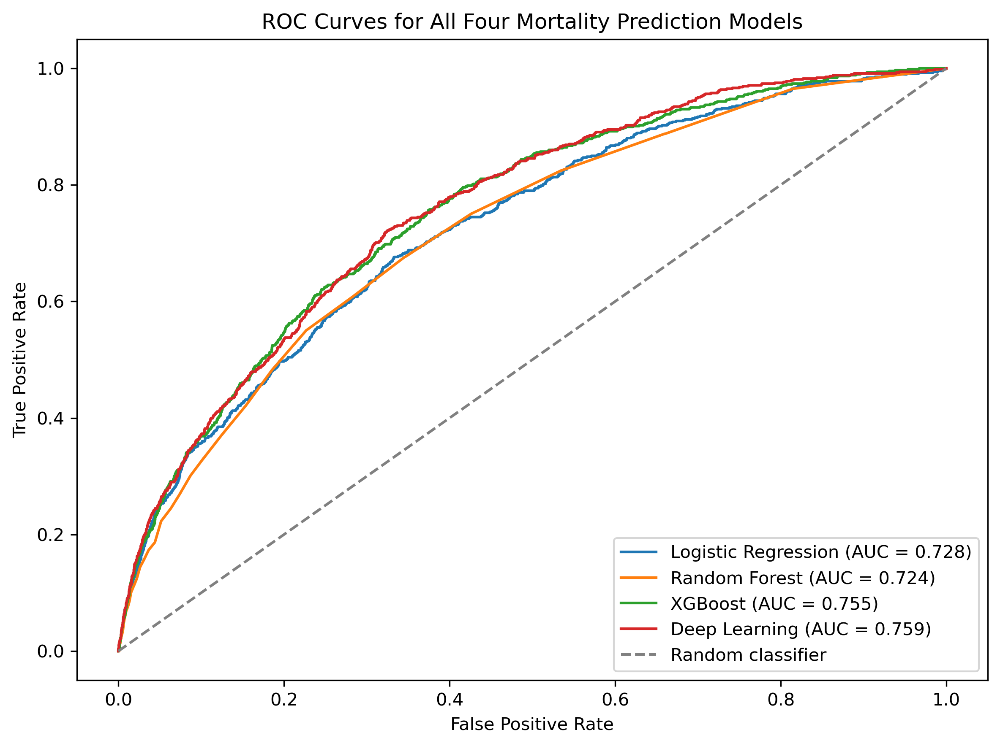
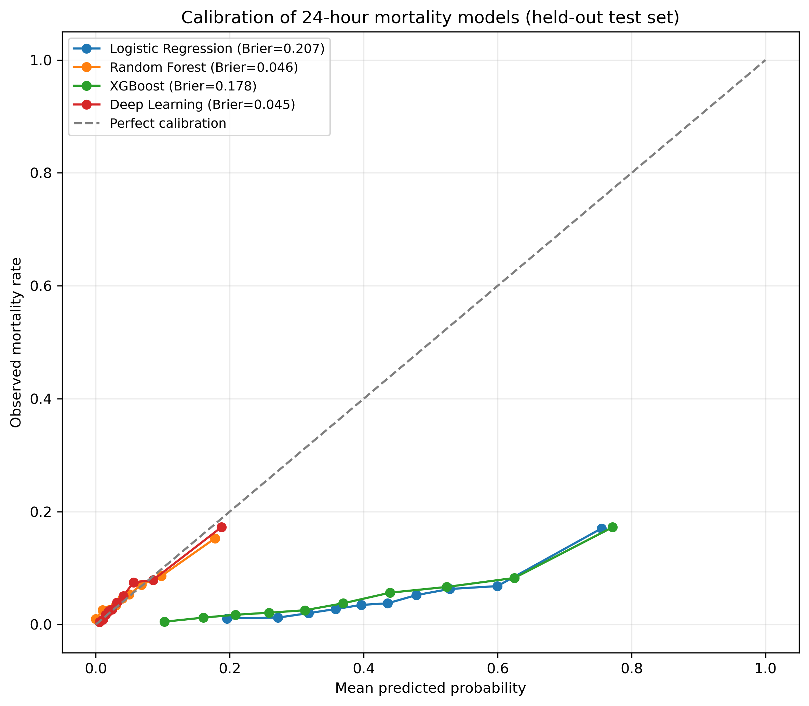
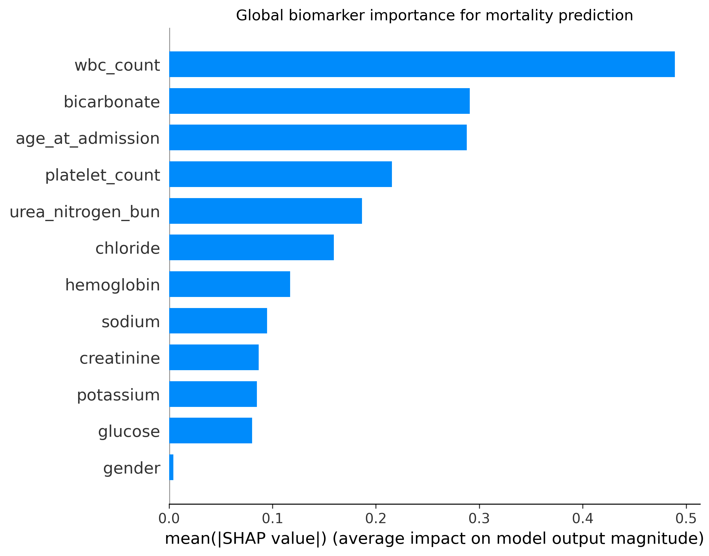

# Predicting In-Hospital Mortality in Heart Failure from First-24-Hour Blood Tests (MIMIC-IV)

MSc Data Science dissertation project – University of Salford, 2026 (Distinction).
This public version was revised after submission (see *Changes since submission*).

## Question
For a patient still in hospital 24 hours after a heart-failure admission, can routine blood tests from those first 24 hours predict in-hospital death, and which biomarkers drive that prediction?

## Data
- **Source:** MIMIC-IV hospital module (Beth Israel Deaconess Medical Center, USA), accessed through PhysioNet under a credentialed data use agreement.
- **The data are not included in this repository**, and the data use agreement does not allow them to be shared. To re-run the notebook, get access at <https://physionet.org/content/mimiciv/> and place these files next to the notebook: `patients.csv.gz`, `admissions.csv.gz`, `diagnoses_icd.csv.gz`, `d_icd_diagnoses.csv.gz`, `d_labitems.csv.gz`, `labevents.csv.gz`.

## Cohort
| Step | Admissions |
|---|---|
| All heart-failure admissions (ICD-9 428.x, ICD-10 I50.x) | 80,611 |
| With at least one selected early biomarker | 73,479 |
| Still in hospital and alive at 24 hours (final cohort) | 69,220 |

- Unique patients in final cohort: 29,251
- In-hospital mortality after 24 hours: 4.9%
- Test set: 5,872 patients, kept completely separate from training

## Method
1. **Cohort:** heart-failure admissions identified from ICD-9/10 codes; one row per admission.
2. **Landmark eligibility (enforced with assertions):** only admissions with a stay longer than 24 hours and no recorded death by 24 hours.
3. **Features:** earliest value in the first 24 hours of 10 routine biomarkers (bicarbonate, chloride, creatinine, glucose, haemoglobin, platelets, potassium, sodium, urea/BUN, white cell count), plus sex and **age at admission** (derived from MIMIC's `anchor_age` and `anchor_year`).
4. **Data quality:** missingness by outcome, unit consistency and extreme-value review before modelling.
5. **Leakage control:**
   - **Patient-level train/test split** (`StratifiedGroupKFold` grouped by `subject_id`). No patient appears in both sets.
   - The neural network's validation set is also split by patient.
   - Imputation and scaling are fitted on training data only.
6. **Models:** logistic regression, random forest, XGBoost (class-weighted) and a small neural network.
7. **Evaluation on the held-out test set:**
   - ROC-AUC and PR-AUC, with 95% confidence intervals from a 1,000-sample **patient-level** bootstrap
   - Brier score and calibration (reliability) curves
   - Threshold-based metrics at an untuned 0.50 cut-off
8. **Explainability:** SHAP for the XGBoost model.

## Results (held-out test set, patient-level split)
| Model | ROC-AUC [95% CI] | PR-AUC [95% CI] | Brier score |
|---|---|---|---|
| Neural network | 0.759 [0.739, 0.776] | 0.162 [0.141, 0.189] | 0.045 |
| XGBoost | 0.755 [0.736, 0.773] | 0.154 [0.135, 0.177] | 0.178 |
| Logistic regression | 0.728 [0.709, 0.748] | 0.145 [0.128, 0.171] | 0.207 |
| Random forest | 0.724 [0.704, 0.743] | 0.128 [0.112, 0.147] | 0.046 |

PR-AUC no-skill baseline: about 0.05 (the mortality rate).

**Interpretation**
- The neural network and XGBoost performed **comparably**: their confidence intervals overlap almost completely, so neither is clearly better. Both outperformed logistic regression and random forest.
- PR-AUC is about three times the no-skill baseline, which is useful discrimination for a rare (about 5%) outcome, but well short of clinical-grade performance.
- XGBoost and logistic regression have high Brier scores because class weighting pushes their predicted probabilities upwards. Their risk rankings are useful, but their raw probabilities need recalibration before being read as actual risks.
- The neural network's and random forest's Brier scores (0.045–0.046) are close to the no-skill value of about 0.047 for a 4.9% outcome, so good calibration here partly reflects predictions staying near the base rate.

**Most influential predictors in XGBoost (SHAP):** white cell count, bicarbonate, age at admission, platelet count and urea (BUN).





## Limitations
- The cohort is defined by ICD codes, which are assigned at discharge and so are not known at the 24-hour prediction point (retrospective cohort selection).
- Data come from one US hospital, and the model has not been externally validated on UK or NHS data.
- Ages above 89 are de-identified in MIMIC-IV, so age is approximate for the oldest patients.
- Performance comes from one held-out split; patient-grouped cross-validation is not yet implemented.
- Confusion-matrix metrics use an untuned 0.50 threshold, and class weighting distorts raw probabilities (see the calibration plot).
- SHAP shows association with the prediction, not causation, and explains XGBoost only.
- Research only; not suitable for clinical use.

## Changes since submission
- Train/test split changed from admission level to **patient level**, to prevent the same patient appearing in both sets.
- 24-hour eligibility is now enforced, not only reported.
- Age at admission replaces `anchor_age`.
- Calibration, Brier scores and patient-level bootstrap confidence intervals added.
- The best-performing model is now selected from the results rather than hard-coded.
- The Kaplan–Meier and Cox analysis was removed: it used a different cohort and treated discharge as uninformative censoring, which would need a competing-risks approach.
- Patient-level outputs were removed to comply with the PhysioNet data use agreement.

## How to run
```bash
pip install -r requirements.txt
jupyter notebook heart_failure_mortality_FINAL.ipynb
```

## Tools
Python, pandas, NumPy, scikit-learn, XGBoost, SHAP, TensorFlow/Keras, Matplotlib
